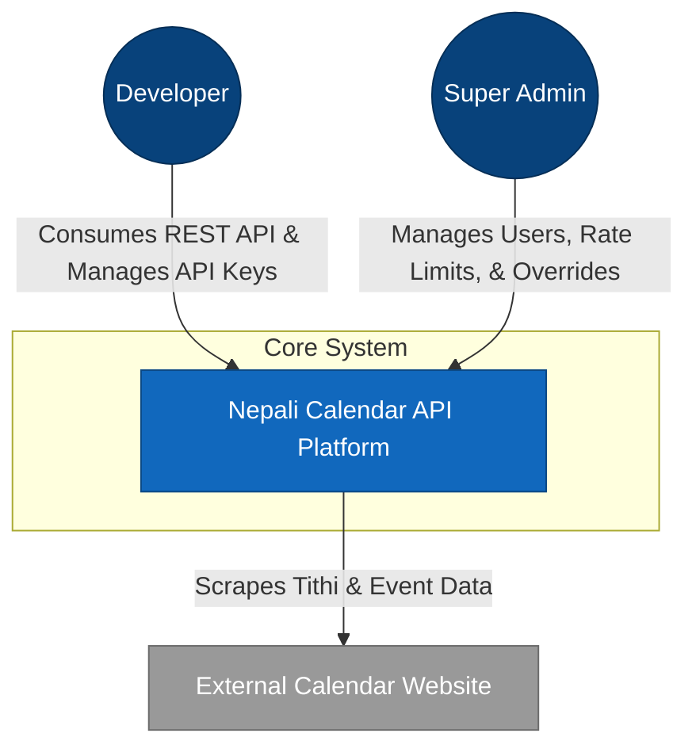

# Nepali Calendar API - Architecture & C4 Model

This document outlines the architecture, data models, and system interactions for the **Nepali Calendar API**. It is specifically designed to provide context for AI agents (like Claude and Antigravity) to facilitate better agentic coding, refactoring, and feature expansion in the future.

---

## 1. System Overview

The **Nepali Calendar API** is a Next.js 14+ (App Router) based commercial platform providing Bikram Sambat (BS) calendar data, Panchanga, event tracking, and date conversions. 

### Core Tech Stack
- **Framework**: Next.js (App Router)
- **Database**: PostgreSQL 16
- **ORM**: Prisma
- **Styling**: Tailwind CSS
- **Authentication**: JWT & API Keys
- **Data Source**: Internal calculation + External Web Scraper

---

## 2. C4 Model 

### Level 1: System Context

The System Context shows how the Nepali Calendar API interacts with its users and external systems.



### Level 2: Container

The Container diagram zooms into the API Platform to show the high-level technical execution units.

```mermaid
graph TD
    Dev((Developer))
    Admin((Super Admin))

    subgraph Nepali Calendar Platform [Next.js Application]
        WebApp[Web Frontend / Dashboard\n(Next.js React Server Components)]
        RestAPI[REST API Layer\n(Next.js Route Handlers)]
        ScraperCron[Cron & Scraper Engine\n(Next.js API & Server Actions)]
    end

    DB[(PostgreSQL Database\n(Prisma))]
    External[External Calendar Website]

    Dev -->|API Requests| RestAPI
    Dev -->|Views Dashboard| WebApp
    Admin -->|Views Admin Panel| WebApp
    
    WebApp -->|Reads/Writes| DB
    RestAPI -->|Reads/Writes| DB
    ScraperCron -->|Upserts Data| DB
    ScraperCron -->|Fetches DOM| External

    classDef container fill:#438dd5,stroke:#1168bd,color:#fff;
    classDef db fill:#438dd5,stroke:#1168bd,color:#fff,shape:cylinder;
    
    class WebApp,RestAPI,ScraperCron container;
    class DB db;
```

### Level 3: Component (API Layer)

Zooming into the Next.js backend to understand the internal separation of concerns.

```mermaid
graph TD
    Request[Incoming API Request]
    
    subgraph Next.js API Routes (app/api/)
        RateLimiter[Rate Limiter Middleware\n(Auth & Quota Check)]
        CalController[Calendar Controller\n(v1/calendar/*)]
        ConvertController[Conversion Controller\n(v1/convert/*)]
    end
    
    subgraph Internal Lib (src/lib/)
        AuthLib[Auth & JWT Lib\n(lib/auth)]
        PanchangaLib[Panchanga Engine\n(lib/nepali-calendar)]
        ScraperLib[Scraper & Reconciler\n(lib/scraper)]
        PrismaClient[Prisma Client\n(lib/prisma.ts)]
    end

    Request --> RateLimiter
    RateLimiter -->|Validates API Key| AuthLib
    RateLimiter -->|Pass| CalController
    RateLimiter -->|Pass| ConvertController
    
    CalController --> PanchangaLib
    CalController --> PrismaClient
    ConvertController --> PanchangaLib
    
    ScraperLib --> PrismaClient

    classDef component fill:#85bbf0,stroke:#5b9dd9,color:#000;
    class RateLimiter,CalController,ConvertController,AuthLib,PanchangaLib,ScraperLib,PrismaClient component;
```

---

## 3. Data Architecture (Prisma)

The database schema revolves around Users, API Access, and Calendar Data.

1. **Access Management**:
   - `User`: Can be `ADMIN` or `USER`.
   - `Subscription` & `SubscriptionPlan`: Governs rate limits (`requestsPerMinute`, `monthlyRequestLimit`).
   - `ApiKey`: Linked to a `User`. Holds API key strings (`np_live_...`) and specific usage quotas.
   - `ApiUsageLog`: Tracks every API request (endpoint, latency, status code).

2. **Calendar Domain**:
   - `CalendarDate`: The core entity. Stores BS and AD date mappings, Tithis, Panchanga details, and holiday statuses.
   - `CalendarEvent`: Events and festivals (can be linked to multiple dates).
   - `DateOverride`: Admin-specific manual overrides for Tithis or holidays that supersede mathematical or scraped calculations.

---

## 4. Guidelines for Agentic Code & AI Assistants (Claude / Antigravity)

When making modifications or adding features to this codebase, AI agents should adhere to the following architectural rules and best practices:

### Core Architectural Rules
1. **Date Logic Isolation**:
   - NEVER hardcode BS-to-AD conversion logic inside Next.js route handlers (`app/api/...`).
   - ALWAYS use the utilities in `src/lib/nepali-calendar/converter.ts` or `bs-data.ts`.

2. **Rate Limiting & Authentication**:
   - Any new commercial endpoint under `app/api/v1/` MUST be protected by the existing API key validation and rate-limiting middleware.
   - Do not bypass the `ApiUsageLog` creation, as it is strictly required for billing and analytics.

3. **Scraping Resiliency**:
   - The web scraper (`src/lib/scraper/hamro-scraper.ts`) is sensitive to DOM changes. Wrap scraping logic in robust `try/catch` blocks and gracefully degrade if a specific node is missing.
   - Always route scraped data through the `reconciler.ts` to ensure it doesn't arbitrarily overwrite `DateOverride` admin records.

### Database & Prisma Best Practices
1. **Database Access**:
   - Use the singleton Prisma client located at `src/lib/prisma.ts`.
   - For bulk calendar date insertions (e.g., from the scraper), utilize Prisma's `$transaction` to prevent partial data corruption.
2. **N+1 Query Prevention**:
   - Be vigilant about the N+1 query problem. When fetching related records, always use Prisma's `include` or `select` to fetch associations in a single query rather than iterating and firing multiple database queries.
3. **Indexing & Performance**:
   - For queries filtering against large datasets, ensure the relevant fields are indexed in the `schema.prisma`. Use `@index` or `@@index` if introducing new filter patterns for huge queries to prevent table scans.

### Next.js & React Best Practices (App Router)
1. **Server vs. Client Components**:
   - **Default to React Server Components (RSC)** for data fetching, backend logic, and standard UI rendering to minimize client bundle size.
   - **Use `'use client'` sparingly**: Only apply this directive at the very edge/leaves of the component tree where interactivity (hooks like `useState` or `useEffect`, or DOM event listeners like `onClick`) is strictly required.

2. **Data Fetching & Mutations**:
   - **Colocate Data Fetching**: Fetch data directly inside Server Components using `async/await` rather than relying on `useEffect`.
   - **Server Actions**: Prefer Next.js Server Actions for mutations (e.g., submitting forms, updating database records) over creating dedicated API endpoints, unless the endpoint is meant to be consumed by external clients.

3. **Routing Conventions**:
   - Strictly adhere to Next.js App Router conventions: utilize `layout.tsx`, `page.tsx`, `loading.tsx`, and `error.tsx` exactly as intended by the framework.

### CSS & Styling Best Practices (Tailwind CSS)
1. **Utility-First Approach**:
   - Strictly use Tailwind CSS utility classes for styling. Avoid writing custom CSS in `globals.css` or using CSS modules unless absolutely necessary for complex animations or overriding third-party libraries.
2. **Responsive Design**:
   - Follow a mobile-first approach. Use base Tailwind classes for mobile layouts, and utilize responsive breakpoints (`sm:`, `md:`, `lg:`, `xl:`) to progressively adjust layouts for larger screens.
3. **Component Reusability**:
   - For highly repetitive styling strings, extract the markup into reusable React components rather than relying heavily on `@apply` in CSS files. This maintains the explicit, tracing benefits of Tailwind's utility architecture.
4. **Design System Consistency**:
   - Adhere to the pre-defined spacing, color, and typography scales configured in `tailwind.config.ts`. Avoid arbitrary values (e.g., `w-[321px]`) unless managing highly specific, isolated edge cases.

### Node.js & General Backend Best Practices
1. **Error Handling**:
   - **Never swallow errors**. Wrap external network calls and database queries in `try/catch` blocks.
   - Return standardized JSON error responses from API routes with appropriate HTTP status codes (e.g., `400 Bad Request`, `401 Unauthorized`, `403 Forbidden`, `404 Not Found`, `500 Internal Server Error`).

2. **Typing & TypeScript**:
   - Enforce strict typing for all function parameters, return types, and API payloads.
   - Avoid using `any`; define robust interfaces or Prisma generated types to ensure end-to-end type safety.

3. **Performance Optimization**:
   - Utilize `Promise.all()` for concurrent execution of multiple independent asynchronous operations (e.g., fetching from the database and a third-party API simultaneously).

4. **Security Practices**:
   - Never expose internal system variables or secrets to the client. Only environment variables prefixed with `NEXT_PUBLIC_` should be accessed in client-side code.
